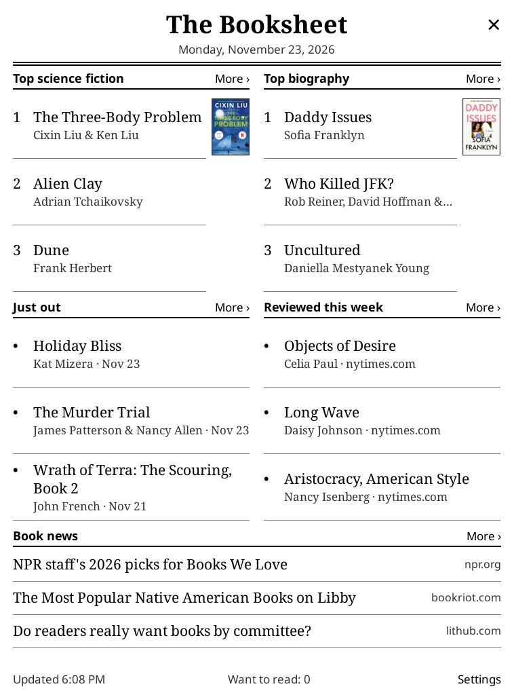

# The Booksheet

A KOReader plugin that gives you a full-screen, one-page newspaper of book news, made up of the sections you choose and pulled from free sources.

- Pick **four sections**: any mix of bestseller lists by genre, **Just out**, and **Reviewed this week**.
- Page through the **top 10** in each section with **More** and **Back**.
- Read **Book news** the way you would in an RSS reader: the newest stories first, from the sources you turn on.
- Tap anything for details, a **QR code** to open it on your phone, or to add a book to your **Want to read** list.

## Tested on

Developed and tested on a **[Kobo model]** running **KOReader [version]**.

The layout has also been checked in KOReader's desktop emulator at common screen sizes from 6 to 10.3 inches. On tall, narrow screens such as the Boox Palma, it currently leaves some empty space above the footer.

Reports from other devices are welcome.

## Install or update

1. Download `booksheet.koplugin.zip` from the [Releases](../../releases) page and unzip it. You should have a folder named `booksheet.koplugin`.
2. Connect your e-reader to a computer with USB.
3. Copy into or replace the `booksheet.koplugin` folder in KOReader's `plugins` folder. On a Kobo that is `.adds/koreader/plugins/`. The `.adds` folder is hidden: on a Mac, press **Cmd+Shift+.** in Finder to show it.
4. Eject the device and restart KOReader.

To uninstall, delete the folder.

## Using it

Open it from the top menu → Tools tab (wrench icon) → **The Booksheet**. You can also assign it to a gesture in KOReader's gesture settings.

### The page

- **More** and **Back** page through a section or Book news without changing the rest of the page.
- Tap a **book** to see its details, get a QR code, or save it to Want to read.
- Tap a **headline** to see its source and date, and get a QR code to the article. When the feed includes the article's text, you can also read it right on your e-reader.
- Tap **Updated** in the bottom-left corner to update now.
- Tap **Want to read** at the bottom to see the books you saved. They stay on your list after they leave the page.

### Book news

Book news is a plain feed. It shows the 20 newest stories from the past 7 days across the sources you turn on, newest first. Videos and sponsored posts are left out. Nothing else is filtered or ranked, so if two outlets cover the same story, you'll see both.

### Settings

Tap **Settings** in the bottom-right corner:

- **Your sections**: choose what goes in each of the four spots.
- **Book covers**: show or hide the cover on the #1 book of each bestseller list.
- **Text size**: small, medium or large.
- **News sources**: The New York Times, NPR Books, Lit Hub, Book Riot, Locus, Reactor and The eBook Reader.
- **Want to read**: your saved books.
- **Book QR codes open at**: Bookshop.org, Kobo, Amazon, Apple Books, Libby or WorldCat. For Libby, you can enter your library so the code opens a search there.
- **Update automatically**: on open, once a day, or manually. "On open" updates when the page is at least an hour old.

## Where the information comes from

- **Bestseller lists** and **Just out**: Apple Books.
- **Reviewed this week**: The New York Times.
- **Book news**: the public feeds of the sources you turn on.

The Booksheet needs Wi-Fi to update, and the last update stays available offline. It doesn't use an account. Your settings and Want to read list stay on your device.

The Booksheet isn't affiliated with or endorsed by any of these sources or stores.

## Credits

Written by David Friedman, working with [Claude](https://claude.com/claude-code), Anthropic's AI model.

## License

[AGPL-3.0](LICENSE), the same license as KOReader.
